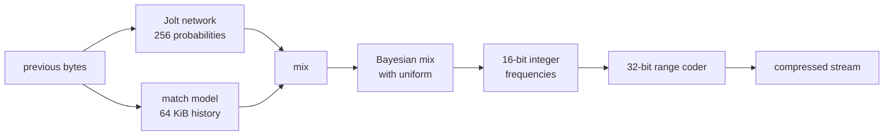
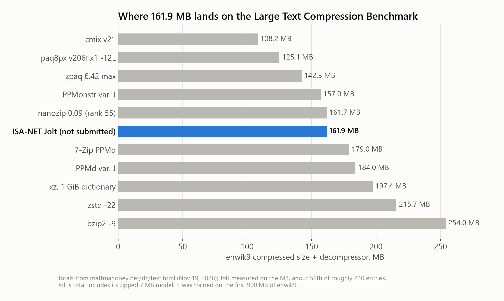
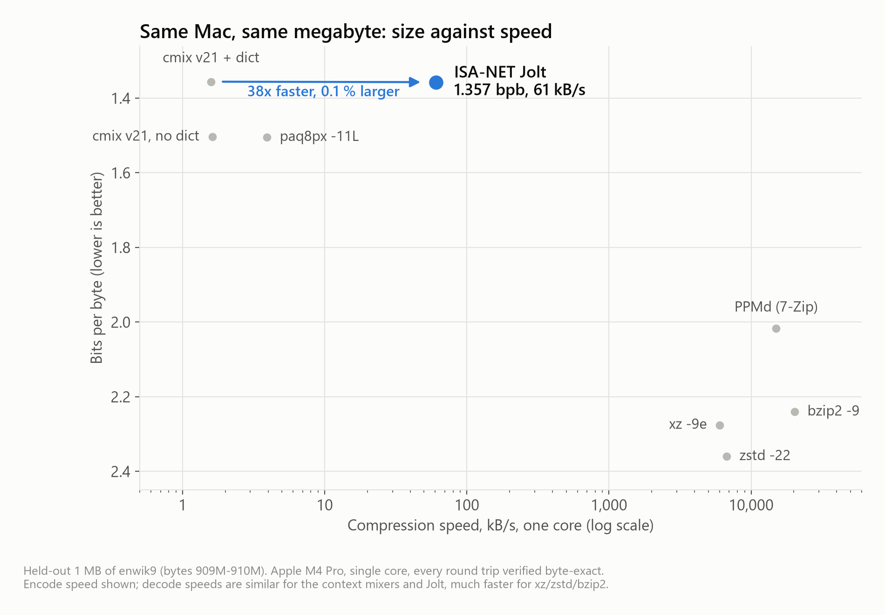
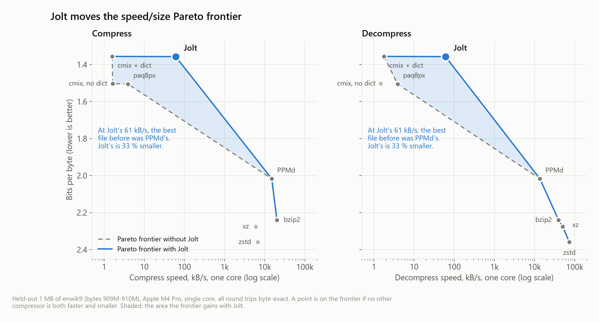
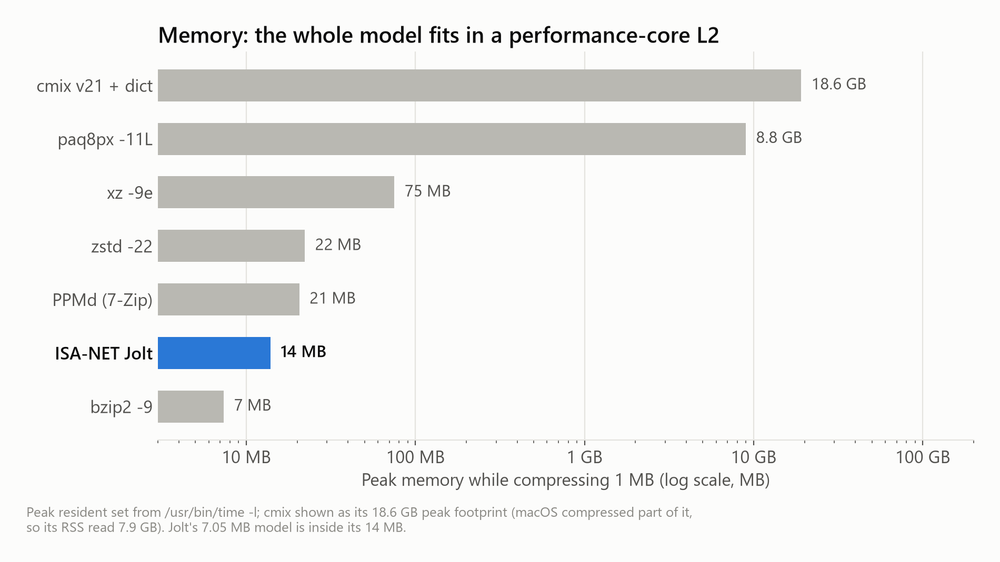
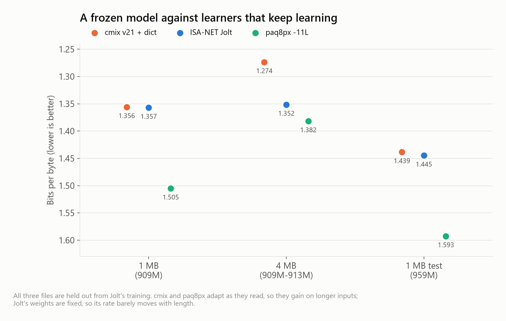
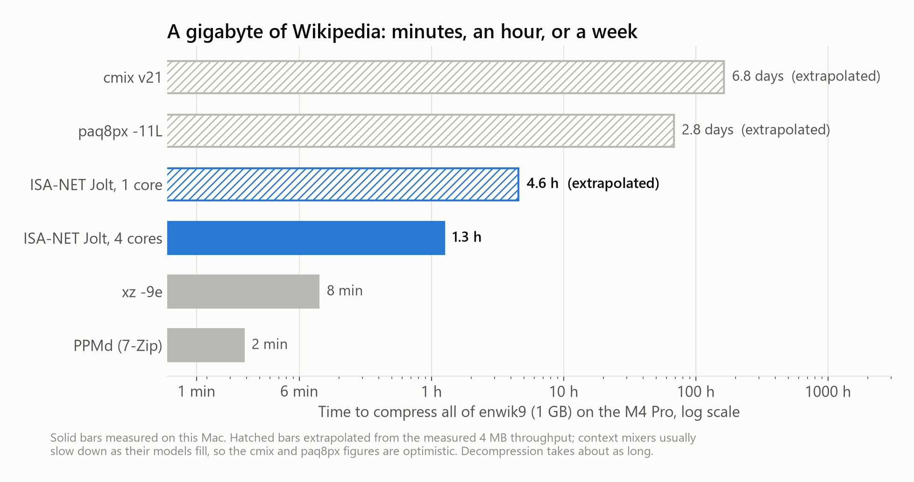

## Introduction

There is a prize for compressing Wikipedia. Marcus Hutter will pay you real money, €5,000 for every percent, to squeeze the first gigabyte of an English Wikipedia dump smaller than the current record. The people who win it run descendants of cmix: hundreds of hand-built context models, a small neural network mixing them, gigabytes of RAM, and days of CPU time to compress one file.

I didn't win it.

<!-- TODO David: one or two lines in your voice on the Hutter attempt (zmix?) and why you stopped, or cut this. -->

But on the way, I built something I like more: a **7 MB network made of XORs, popcounts and INT8 dot products** that compresses Wikipedia text about as well as cmix, while running **38 times faster** and using **a thousandth of the memory**. It never leaves the L2 cache of a single M4 core.

In the [last post](/posts/m4-tinystories/), an M4 CPU learned to tell children's stories with a language model built from the instructions it already has: `FCMGE` compares to make bits, `EXT`/`BSL`/`EOR` logic to transform them, `CNT` and `SDOT` to turn them back into numbers. This is the story of what happened when I pointed the same idea at one of the oldest questions in machine learning: *how well can you predict the next byte?*

> The premise of the Hutter Prize is that compressing text well *requires* understanding it. A model that knows English, and Wikipedia, and how articles are put together, can guess the next byte better, and every better guess is a smaller file.

Here's what came out, measured end to end on an Apple M4 Pro:

* **enwik9** (the first gigabyte of an English Wikipedia dump) goes down to **155,874,783 bytes**, and comes back out **byte-for-byte identical**. With the zipped decompressor and its embedded 7 MB model, that's **161,855,306 bytes, 1.295 bits per byte**, which would sit about **56th** on Matt Mahoney's [Large Text Compression Benchmark](https://mattmahoney.net/dc/text.html), a few places behind PPMonstr.
* On held-out Wikipedia text, on the same Mac, it compresses within **0.1 %** of **cmix v21**, one of the strongest compressors ever written, while running **38× faster** on one core and using **14 MB** of memory instead of **18.6 GB**.

***TL;DR: a 7 MB integer/Boolean network that never leaves the L2 cache compresses Wikipedia about as well as cmix on a megabyte, beats paq8px, and does a gigabyte in 75 minutes on four M4 Pro cores instead of a week.***

<!-- markdownlint-capture -->
<!-- markdownlint-disable -->
> **The caveat, up front:** the model was trained on the first 900 MB of enwik9, so the full-file number is corpus-tuned. Everything in the head-to-head comparison with cmix is measured on bytes the model never saw. I'll repeat this wherever it matters.
{: .prompt-warning }
<!-- markdownlint-restore -->

---

## Prediction is compression

An arithmetic (range) coder can encode a symbol with probability $p$ in almost exactly $-\log_2 p$ bits. If a model assigns probability $p(x_i \mid x_{<i})$ to each byte, the compressed size of a file is

$$
\text{bits} \approx \sum_i -\log_2 p(x_i \mid x_{<i})
$$

which is just the model's cross-entropy on the file. Bits per byte (bpb), the metric from the TinyStories post, *is* the compression ratio: 8 bpb is no compression, 2 bpb is a 4:1 ratio, 1.25 bpb is 6.4:1.

The catch is that the decoder has to run the same model and get the **exact same** probabilities, bit for bit, or the arithmetic decoder desynchronises and the rest of the file turns to garbage. A neural network that is "almost deterministic" is not good enough. One flipped rounding decision in byte 400,000,000, and the remaining 600 MB of Wikipedia comes out as line noise. *No pressure.*

---

## From stories to bytes

The TinyStories model used a 2,048-token BPE vocabulary and a 256-token context. For compression, I switched to raw bytes: no tokeniser to ship, no tokeniser side-information, and every one of the 256 symbols gets a probability at every step. The model that came out of the search is called **Jolt**:

| Component | Jolt |
| --- | --- |
| Input | raw bytes, 256 symbols |
| Context | 1,536 bytes |
| Blocks | 4 |
| Residual width | 256 |
| Attention | 8 heads; in alternate blocks 7 of them see only a 32-byte window and 1 stays global; clipped-linear normaliser, no `exp` |
| Attention projections | INT8 `SDOT`, prepacked tickets; output projection keeps half its blocks |
| Boolean FFN | 2,048 bits, 3 rounds of learned 3-input logic, `EOR`+`CNT`+`SDOT` decode |
| Hashed n-gram tables | orders 3, 4 and 6, two hash heads each, 64-channel INT8 rows |
| Readout | 64-bit Boolean vocabulary code + rank-64 numerical correction |
| Deployed model image | **7,052,160 bytes** |

The architecture is the same family as the story model: numerical residuals and attention geometry around a wide Boolean feed-forward program. The big new ingredient is the hashed n-gram tables.

### Hashed n-gram tables

Byte-level models have a cold-start problem: a single byte carries very little information, so the network has to spend its first layers just assembling characters into word fragments. The n-gram tables short-circuit that. For each position, the previous 3, 4 and 6 bytes are hashed (a multiply-XOR hash, two hash heads per order) into tables of learned 64-channel INT8 rows, which are summed into the input embedding. On the CPU this is a handful of integer multiplies and three cache-resident row loads per byte: about the cheapest "memory" a network can have. The tables are most of the 7 MB model, and they are exactly what you'd want next to a model whose whole point is that its state fits in a 16 MB L2.

### Training

Jolt was trained on the first 900,000,000 bytes of enwik9 (on my [GH200 workstation](/posts/hopper/)), using the straight-through/multilinear Boolean training from the last post. The final checkpoint saw about 3.2 billion bytes, roughly three and a half passes over the training split, and reached 1.310 bpb on the validation split (bytes 900M-950M). Bytes 950M-1000M were held back as a test split.

---

## The codec

A model is not a compressor. Jolt's native binary wraps the network in four more pieces:



* **A match model.** Wikipedia repeats itself: templates, infobox fields, citation boilerplate. A small match model hashes the last six bytes into a 65,536-entry table of positions in a 64 KiB history, verifies the candidate, and predicts that the next byte continues the match, with a confidence that depends on how long the match has run. Its prediction is linearly mixed into the network's.
* **A safety net.** The mixed distribution is mixed once more with the uniform distribution, with the weight updated as an exact Bayesian posterior. On text the network wins and the uniform weight vanishes; on data the model has never seen anything like (binary, a different language) the coder can never do much worse than 8 bits per byte.
* **Integer frequencies.** The probabilities are quantised to a 16-bit frequency table in which every symbol gets at least one count, so no byte is ever impossible, and the Bayesian update runs on those integer frequencies, not on the floating-point probabilities, so encoder and decoder agree exactly.
* **A range coder.** A classic 32-bit, LZMA-style range coder turns the frequencies into bits.

### Determinism

The network uses `-ffast-math`, FP16 arithmetic and hand-written NEON, so its outputs depend on the exact instruction sequence. That's fine, as long as compression and decompression run the *same* binary. The stream header carries a fingerprint of the exported weights and of the arithmetic build, and a mismatched decoder refuses to start rather than producing garbage. Every result in this post was round-tripped and compared byte-for-byte, or by SHA-256.

### Four lanes

A single core decodes about 61 kB/s. For the full gigabyte, the file is split into four lanes, each with its own model state, KV cache, match model and range coder, running on four performance cores. The lanes share one read-only copy of the weights. That costs a little compression (each lane starts cold) and gets almost exactly 4× the speed.

---

## The full gigabyte

| Measure | Value |
| --- | ---: |
| Input | enwik9, 1,000,000,000 bytes |
| Compressed stream | **155,874,783 bytes** (1.2470 bpb) |
| Decompressor (zip -9, model included) | 5,980,523 bytes |
| Total, LTCB-style | **161,855,306 bytes** (1.2948 bpb) |
| Compress / decompress | 4,501 s / 4,522 s (about 75 minutes each, four M4 cores, 220 kB/s) |
| Peak memory | 2.5 GB compress / 2.1 GB decompress, mostly whole-file buffers |
| Round trip | exact (SHA-256 match) |



On the LTCB table that lands between nanozip (161.7 MB) and kanzi's TPAQX mode (162.1 MB), about 56th of roughly 240 entries. Every LZ-family compressor is far behind: 18 % smaller than xz with a 1 GiB dictionary, 25 % smaller than `zstd -22`. PPMonstr, Dmitry Shkarin's heavyweight PPM, is 4.8 MB smaller in total.

Interestingly, on the compressed stream alone Jolt (155.9 MB) is *smaller* than PPMonstr (157.0 MB). It loses on the decompressor, because the decompressor contains the model, and 7 MB of INT8 weights doesn't zip down much. That's the honest accounting for a pretrained compressor: the knowledge has to be paid for somewhere.

And again: those 155.9 MB include 900 MB the model was trained on. LTCB's rules allow it (the decompressor size is what keeps it honest), but it's not a measure of generalisation. For that, we need held-out data and a fair fight.

---

## A fair fight, on one machine

Benchmarks published in different years on different machines are hard to compare, so I ran everything on the same Apple M4 Pro (24 GB, macOS, on mains power, nothing else running), on the same files:

* **dev**: enwik9 bytes 909,000,000-910,000,000 (1 MB) and 909,000,000-913,000,000 (4 MB), from Jolt's validation split
* **test**: bytes 959,000,000-960,000,000 (1 MB), from Jolt's test split

Neither was ever trained on. The contenders:

* **cmix v21**, Byron Knoll's context-mixing compressor (with its English dictionary, and without), rank 22 on LTCB
* **paq8px v217**, at `-11L` (`-12L` wants more than the Mac's 24 GB)
* **PPMd** (7-Zip), **xz -9e**, **zstd -22**, **bzip2 -9** as the classical baselines

Every tool ran single-threaded; encode and decode were timed separately; every round trip was verified by SHA-256.



The 1 MB dev slice, in numbers:

| Compressor | bpb | Compress kB/s | Decompress kB/s | Peak memory |
| --- | ---: | ---: | ---: | ---: |
| cmix v21 + dictionary | **1.3559** | 1.6 | 1.8 | 18.6 GB |
| **ISA-NET Jolt** | **1.3572** | **60.7** | **60.6** | **14 MB** |
| cmix v21, no dictionary | 1.5033 | 1.6 | 1.5 | 18.4 GB |
| paq8px v217 -11L | 1.5051 | 3.9 | 3.9 | 8.8 GB |
| PPMd (7-Zip, order 16) | 2.0172 | 15,000 | 13,600 | 21 MB |
| bzip2 -9 | 2.2403 | 20,200 | 39,800 | 7 MB |
| xz -9e | 2.2758 | 6,000 | 50,600 | 75 MB |
| zstd -22 --long=30 | 2.3594 | 6,700 | 73,800 | 22 MB |

On this megabyte Jolt is 161 bytes larger than cmix, 0.1 %, and 38× faster to compress, 34× faster to decompress. It beats paq8px by 10 % at 15× the speed. The classical compressors are hundreds of times faster still, and 49 to 74 % larger.

### Moving the frontier

A cleaner way to see this is the Pareto frontier: the set of compressors for which nothing else is both faster *and* smaller. Before Jolt, the frontier on this file ran cmix → paq8px → PPMd → bzip2, and between paq8px at 4 kB/s and PPMd at 15,000 kB/s there was nothing: if you wanted anything faster than paq8px, you had to accept a 2.0 bpb file.



Jolt knocks paq8px off the frontier, both for compression and decompression, and fills that hole. At 61 kB/s it produces files **33 % smaller** than anything that was at least as fast before (PPMd), and the frontier bulges outwards by the whole shaded area.

The memory chart is the one that makes me smile:



cmix allocates about 18.6 GB up front for its hundreds of models and its LSTM. Jolt's entire working set is 14 MB, half of which is the model itself. That's a factor of more than a thousand, and it's the reason Jolt is fast: nothing it touches per byte ever leaves the performance cluster's L2.

> In fairness to cmix, a 24 GB Mac is not its natural habitat. macOS spent a good part of each cmix run compressing cmix's own memory to make it fit, which is a little ironic for a compression benchmark, and it swapped a bit during one run. Give it 32 GB and it would be somewhat faster. Even if I credit it all of that time back, Jolt is still more than 20× faster.
{: .prompt-info }

---

## Where cmix pulls ahead



On 4 MB the picture changes: cmix drops to 1.274 bpb while Jolt stays at 1.352, a 6 % gap. paq8px closes most of its gap too.

This is the fundamental difference between the two designs. cmix and paq8px are *online learners*. They start knowing almost nothing (cmix's dictionary aside) and adapt to the file as they read it: every byte updates thousands of context statistics and the LSTM's weights. The longer the file, the better they get. Jolt is a *frozen* model: everything it knows was learned in pretraining, and it brings that knowledge from byte one. It's at its best on short inputs, and it doesn't improve with length (only the match model and the 1,536-byte context adapt).

Which is better depends entirely on what you're compressing. For a megabyte of Wikipedia-like text, pretraining wins on speed by a mile and ties on size. For a gigabyte, online learning wins on size. The obvious hybrid, a frozen network plus a cheap online layer on top, is where this goes next.

---

## A gigabyte, start to finish



Running cmix or paq8px over a gigabyte on this Mac would take days, so those bars are extrapolated from the measured 4 MB throughput, and they're optimistic (context mixers tend to slow down as their tables fill). The xz, PPMd and Jolt four-core bars are measured. Published LTCB times from other machines tell the same story: cmix v21 at about 623 µs per byte, paq8px at 292 µs per byte.

Jolt, on four M4 Pro cores, does the whole gigabyte in about 75 minutes each way. On one core it would be about four and a half hours.

---

## The Scorecard

| | ISA-NET Jolt | cmix v21 |
| --- | ---: | ---: |
| 1 MB held-out Wikipedia | 1.357 bpb | 1.356 bpb |
| 4 MB held-out Wikipedia | 1.352 bpb | **1.274 bpb** |
| Compress speed, one core | **60.7 kB/s** | 1.6 kB/s |
| Peak memory | **14 MB** | 18.6 GB |
| Learns while compressing | no | yes |
| enwik9, total with decompressor | 161.9 MB | **108.2 MB** |
| Time for enwik9 | **75 minutes** (4 cores) | about a week (1 core, extrapolated) |
| Fits in L2 | yes | *lol* |

---

## Caveats, plainly

* **Training overlap.** Jolt was trained on enwik9's first 900 MB. The full-file and LTCB numbers are corpus-tuned. The head-to-head numbers are on held-out bytes.
* **Side information.** Jolt's 7 MB model and cmix's English dictionary are knowledge the compressor brings with it. The slice comparisons don't count either; the enwik9 total counts Jolt's.
* **cmix was memory-starved.** cmix wants about 18.7 GB; on a 24 GB Mac, macOS compressed some of its memory and it swapped a little during one run. Its speed here is somewhat understated. Even crediting it all its system time back, Jolt stays more than 20× faster.
* **paq8px ran at `-11L`**, not its best `-12L`, for the same memory reason.
* **cmix and paq8px full-file times are extrapolated**, as marked on the chart. Their full-file sizes are LTCB's published numbers.
* **Not submitted.** Jolt isn't on the LTCB table; the placement is where its numbers would fall.

---

## Conclusion

So, did the XORs win? Not the Hutter Prize. But a 7 MB model made of compares, XORs, popcounts and INT8 dot products, which never leaves one core's L2, compresses unseen Wikipedia text as well as cmix on a megabyte, at 38 times the speed and a thousandth of the memory. On the full gigabyte it lands around 56th on the LTCB, ahead of every LZ compressor and a few places behind PPMonstr, in 75 minutes on four M4 Pro cores.

What it can't do yet is learn while it compresses. cmix's advantage on longer files is online adaptation, and the frozen network has none beyond its context window and match model. Putting a small online learner on top of a pretrained, cache-resident network is the obvious next experiment.

<!-- TODO David: closing line in your voice. -->

The same silicon that two months ago was telling children's stories about girls eating trees now packs Wikipedia at a quarter of a megabyte per second. Not bad for instructions that were designed for video codecs and cryptography.

---

## References and reproducibility

* Matt Mahoney, [Large Text Compression Benchmark](https://mattmahoney.net/dc/text.html) (accessed November 2026)
* Byron Knoll, [cmix](https://www.byronknoll.com/cmix.html)
* [paq8px](https://github.com/hxim/paq8px)
* Dmitry Shkarin, PPMd and PPMonstr
* The previous post: [Teaching an M4 CPU to Tell Stories with XOR, Popcount and SDOT](/posts/m4-tinystories/)

Benchmark protocol: single core unless marked, encode and decode timed separately, median of 3-5 runs for fast tools and Jolt, 1 run for cmix and paq8px, peak memory from `/usr/bin/time -l`, every round trip verified by SHA-256. Machine: Apple M4 Pro, 24 GB, macOS 27.2, Apple clang 21.

## Citing This Work
```bibtex
@article{ng2026isanetcompression,
  title   = {Compressing Wikipedia with XOR, Popcount and SDOT},
  author  = {Ng, David Noel},
  year    = {2026},
  month   = {November},
  url     = {https://dnhkng.github.io/posts/isa-net-compression/}
}
```
{: .nolineno }
